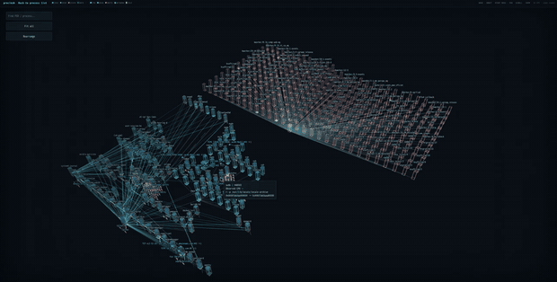
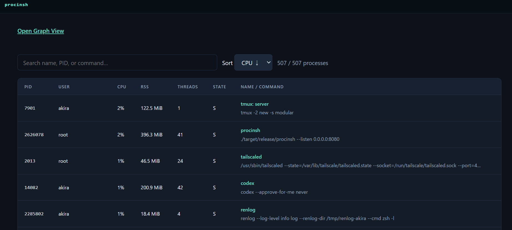

# ProcInSh - Process in the Shell

ProcInSh (pronounced "proc-in-shell") is a web-based process inspector for Linux.
Like [Ghost in the Shell](https://en.wikipedia.org/wiki/Ghost_in_the_Shell), you can wander through process space with your ghost.

[Interactive demo](https://akawashiro.github.io/procinsh/main/demo/replay/space/?recording=chrome-ubuntu26&tour=1), [Blog post](https://akawashiro.com/articles/procinsh-en), [Discord](https://discord.gg/aQuNSczpw)

## Screenshot






## Usage

Requires Linux x86-64. Both installation methods compile native code and require
Rust, a C compiler, clang with the BPF backend, bpftool, pkg-config, libelf and
zlib development files, and BTF information at `/sys/kernel/btf/vmlinux`.

Support on WSL2 is very limited, I recommend building procinsh from source rather than installing it from crates.io.

**Security warning: ProcInSh makes sensitive information on your machine, including process memory and environment variables accessible through your browser. Use extreme caution when exposing the service beyond localhost with `--allow-non-loopback`**

### Install from crates.io

Install [procinsh from crates.io](https://crates.io/crates/procinsh) and run it:

(Sorry, we assume you are using Ubuntu, please reinterpret not so)
```sh
sudo apt-get install --yes --no-install-recommends \
         build-essential clang llvm pkg-config libelf-dev zlib1g-dev libcap2-bin python3 \
         linux-tools-common linux-tools-generic
cargo install procinsh --locked
```

Cargo installs two executables. Grant inspection capabilities only to the
helper, then run the main executable as your ordinary user:

ProcInSh should work even if you drop some capability (for example, you may want not to pass `CAP_SYS_ADMIN` because it is very strong).
However, the appearance will be worse comparing to full capabilities.

```sh
sudo setcap \
  cap_sys_ptrace,cap_bpf,cap_perfmon,cap_dac_read_search,cap_sys_admin=ep \
  "$HOME/.cargo/bin/procinsh-privileged-helper"
"$HOME/.cargo/bin/procinsh" --listen 127.0.0.1:9090
```

### Self build on Linux

#### Ubuntu

Also requires Node.js 22.12 or newer with npm and Rust via rustup. The Rust version
and components are pinned in `rust-toolchain.toml`; rustup installs them
automatically when needed.

Clone this repository and run the following from its root:

```sh
sudo apt-get install --yes --no-install-recommends \
         build-essential clang llvm pkg-config libelf-dev zlib1g-dev libcap2-bin python3 \
         linux-tools-common linux-tools-generic
npm --prefix web ci
npm --prefix web run build
cargo build --release --locked
```

Then run:

```sh
sudo setcap \
  cap_sys_ptrace,cap_bpf,cap_perfmon,cap_dac_read_search,cap_sys_admin=ep \
  ./target/release/procinsh-privileged-helper
./target/release/procinsh --listen 127.0.0.1:9090
```

#### NixOS

With Rust installed via rustup, create `shell.nix` in the repository root:

```nix
{ pkgs ? import <nixpkgs> { } }:
pkgs.mkShell {
  packages = with pkgs; [ nodejs_22 clang llvm pkg-config elfutils zlib libcap bpftools gnumake ];
  hardeningDisable = [ "all" ];
}
```

Build the web assets and binary inside the Nix shell:

```sh
nix-shell --run 'npm --prefix web ci --no-audit --no-fund && npm --prefix web run build && cargo build --release --locked'
```

The binary links to libraries such as `libelf` in `/nix/store`. Create a GC root
to keep these dependencies from being removed by `nix-collect-garbage`:

```sh
nix-build shell.nix -A inputDerivation -o .nix-gcroot
```

Keep `.nix-gcroot` while using the binary. Then run:

```sh
sudo setcap \
  cap_sys_ptrace,cap_bpf,cap_perfmon,cap_dac_read_search,cap_sys_admin=ep \
  ./target/release/procinsh-privileged-helper
./target/release/procinsh --listen 127.0.0.1:9090
```

### Building on WSL2 (Ubuntu)

Ubuntu's `bpftool` wrapper may fail with `bpftool not found for kernel ...`
because the WSL2 kernel version differs from the Ubuntu tools package. Set
`BPFTOOL` to the packaged executable directly, bypassing the wrapper:

```sh
sudo apt-get update
sudo apt-get install --yes --no-install-recommends \
         build-essential clang llvm pkg-config libelf-dev zlib1g-dev libcap2-bin python3 \
         linux-tools-common linux-tools-generic
for tool in /usr/lib/linux-tools/*/bpftool; do
    if [ -x "$tool" ]; then
        export BPFTOOL="$tool"
        break
    fi
done
"${BPFTOOL:?No packaged bpftool found; install linux-tools-generic}" version
"$BPFTOOL" btf dump file /sys/kernel/btf/vmlinux format c >/tmp/procinsh-vmlinux.h
npm --prefix web ci
npm --prefix web run build
cargo build --release --locked
```

Then run:

```sh
sudo setcap \
  cap_sys_ptrace,cap_bpf,cap_perfmon,cap_dac_read_search,cap_sys_admin=ep \
  ./target/release/procinsh-privileged-helper
./target/release/procinsh --listen 127.0.0.1:9090
```

_Now, where shall I go? The process space is vast._
