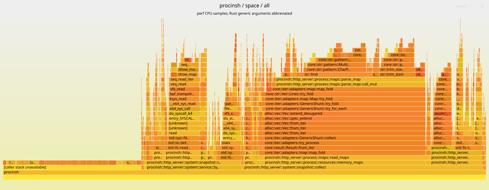

# Backend CPU under Chrome load — 2026-10-17

In this run, opening a process detail page used **21.83%** of one CPU for
Chrome's browser process and **16.92%** for a busy renderer. Opening SPACE used
**32.62%**. The strongest optimization candidates are perf ring-buffer copying
in process detail and memory-map collection/parsing in SPACE.

The measured executable is the **unoptimized debug build** of
[`54b714c34d17541cfd7f3b89bb99ab79f1a12c54`](https://github.com/akawashiro/procinsh/commit/54b714c34d17541cfd7f3b89bb99ab79f1a12c54),
the head of [PR #221](https://github.com/akawashiro/procinsh/pull/221) at measurement
time. These results do not measure main, an optimized release build, or a
before/after improvement. The report contains one sequential run per condition;
it does not establish variance or statistical significance.

## CPU and flamegraphs

CPU percentages come from backend `/proc` CPU-time deltas, with **one logical
CPU = 100%**. Each condition has 30 seconds of warmup followed by 60 seconds of
measurement. Chrome's CPU use is excluded from these backend numbers.

| Condition | Backend CPU | User seconds | System seconds | Samples | Combined flamegraph | By-thread flamegraph |
|---|---:|---:|---:|---:|---|---|
| Baseline: server idle, observer blank | 0.00% | 0.00 | 0.00 | 0 | — | — |
| Chrome load, observer blank | 0.00% | 0.00 | 0.00 | 0 | — | — |
| Browser process detail | 21.83% | 11.84 | 1.26 | 1,283 | [PNG](flamegraphs/browser-detail-all.png) / [SVG](flamegraphs/browser-detail-all.svg) | [PNG](flamegraphs/browser-detail-threads.png) / [SVG](flamegraphs/browser-detail-threads.svg) |
| Busy renderer detail | 16.92% | 8.77 | 1.38 | 996 | [PNG](flamegraphs/renderer-detail-all.png) / [SVG](flamegraphs/renderer-detail-all.svg) | [PNG](flamegraphs/renderer-detail-threads.png) / [SVG](flamegraphs/renderer-detail-threads.svg) |
| SPACE | 32.62% | 15.07 | 4.50 | 1,932 | [PNG](flamegraphs/space-all.png) / [SVG](flamegraphs/space-all.svg) | [PNG](flamegraphs/space-threads.png) / [SVG](flamegraphs/space-threads.svg) |

Zero means no CPU ticks or samples were observed in that interval, within the
measurement resolution. No graph is generated for an empty interval.

PNG links work as static images on phones; the PNGs are rendered at twice the
SVG dimensions so labels remain legible when zoomed.



Download an SVG and open it directly in a browser to use its search and zoom
controls. GitHub's image preview may disable those controls. Width represents
sample count within that condition, not elapsed time or absolute CPU use; compare
the CPU column when comparing conditions. Generic arguments are abbreviated in
graph labels.

`perf record -p <backend-pid>` records the process's threads, including inherited
threads created while recording. It does not require a separate recording per
thread. The combined graphs merge thread stacks; the by-thread graphs insert
the recorded thread name and TID as a root, preserving the same sample total.

The largest per-thread CPU contributions illustrate where the work runs:

| Condition | Thread | Backend CPU contribution |
|---|---|---:|
| Browser detail | `observe-3683` (TID 5868) | 16.15% |
| Browser detail | Tokio workers TID 26 / 14 | 2.92% / 2.77% |
| Renderer detail | `observe-3839` (TID 7352) | 10.52% |
| Renderer detail | Tokio workers TID 13 / 39 | 3.23% / 3.17% |
| SPACE | Tokio worker TID 8556 | 23.08% |
| SPACE | Tokio workers TID 13 / 40 | 3.58% / 3.13% |

## What consumes the CPU

These are inclusive shares of each condition's samples. Nested functions overlap
and must not be added. Incomplete caller stacks make these shares lower bounds
for the corresponding callers.

| Condition | Function | Inclusive share |
|---|---|---:|
| Browser detail | `Sampler::poll` | 68.04% |
| Browser detail | `PerfEventReader::drain` | 38.50% |
| Browser detail | `PerfEventReader::copy` | 36.94% |
| Browser detail | `process_sample` | 20.65% |
| Renderer detail | `Sampler::poll` | 51.61% |
| Renderer detail | `PerfEventReader::copy` | 22.09% |
| Renderer detail | `procfs::read_stat` | 14.16% |
| Renderer detail | `process_sample` | 13.45% |
| SPACE | `system::snapshot::collect` | 70.81% |
| SPACE | `maps::read_maps` / `resources::memory_maps` | 40.68% each |
| SPACE | `maps::parse_map` | 30.95% |
| SPACE | `SocketMetadataReader::read` | 12.53% |
| SPACE | `procfs::read_stat` | 11.80% |

In process detail, the copying closure itself accounts for 9.04% of browser-detail
samples and 5.62% of renderer-detail samples as leaf/self work. Range iteration
and volatile-read checks also appear among the leading leaves. The measured
[`PerfEventReader::copy`](https://github.com/akawashiro/procinsh/blob/54b714c34d17541cfd7f3b89bb99ab79f1a12c54/src/http_server/process/snapshot/perf.rs#L148)
reads the ring buffer byte by byte using `read_volatile`. This makes copying and
its debug-build loop/check overhead a concrete target for a focused experiment.
Any replacement must preserve the perf ring-buffer ordering and wraparound
requirements.

In SPACE, string scanning, UTF-8 iteration and whitespace tests are prominent
leaves under memory-map parsing. The measured
[`read_maps` / `parse_map`](https://github.com/akawashiro/procinsh/blob/54b714c34d17541cfd7f3b89bb99ab79f1a12c54/src/http_server/process/maps.rs)
path is a useful target for reducing collection frequency or parsing/allocation
cost. These are hypotheses for follow-up measurements, not demonstrated speedups.

## Experiment setup

The backend, load-generating Chrome, a separate observer Chrome, the Node.js
controller, the Python CPU reader and perf all run inside **one Docker
container**, with a private PID namespace and bridge networking. The host only
orchestrates Docker and converts exported stacks into SVGs.

| Component | Recorded configuration |
|---|---|
| Host CPU / kernel | AMD Ryzen 9 5950X, 32 logical CPUs; Linux `7.0.0-38-generic`, x86-64 |
| Container userspace | Ubuntu 26.04; Chrome `141.0.7390.65`; perf `7.0.14`; Node.js `22.18.0`; Python `3.14.4` |
| Backend | Debug executable with symbols; private PID 7; launched through `scripts/dev_run.sh` |
| Browser users | Workload, observer and controller UID/GID 1000; backend and perf container root |
| Permissions | Drop all capabilities, add `PERFMON`, `SYS_PTRACE`, `BPF`, `DAC_READ_SEARCH`, `SYSLOG`, `IPC_LOCK`; `seccomp=unconfined` |
| Isolation / limits | Read-only root filesystem, writable results mount, 1 GiB `/tmp`, 256 MiB shared memory, unlimited memlock, 8 GiB memory limit, 2,048 PID limit |
| Network | Private bridge; backend port published only on localhost IPv4/IPv6 and the host Tailscale IPv4 |

The container uses neither `--privileged` nor host PID/network namespaces.
Its image ID is
`sha256:996e1547d4f4933ffd23d6704320c470fdf59875bd44a398db2c90123422608f`;
this identifies the local image, not a published or reproducibly built image.

The workload uses [`scripts/chrome_load.mjs`](../../../scripts/chrome_load.mjs)
with `TAB_COUNT=20 INTERVAL_SECONDS=10`: the first 20 entries of
[`scripts/chrome_sites.txt`](../../../scripts/chrome_sites.txt), cache disabled,
headless Chrome, repeated reloads. The observer uses a separate browser profile,
1280×900 viewport and SwiftShader for SPACE. It navigates to one process detail
page or `/space`; only one observation page is active at a time. The renderer is
selected by the largest CPU tick increase among the workload browser's renderer
descendants over a preceding 12-second window.

The controller checks that Chrome remains alive and SSE events continue during
measurement. There are 20 workload tabs with nonempty titles and no logged
navigation errors. Some pages show anti-bot challenge titles, so this is not
evidence that all intended site content loaded successfully. External sites and
their timing make the workload variable.

The recording command, executed inside the container, is equivalent to:

```sh
perf record -e cpu-clock -F 99 \
  --call-graph dwarf,16384 --sample-cpu --clockid mono \
  -p "$BACKEND_PID" -o "$RUN_DIR/perf.data" \
  -- tail --pid="$CONTROLLER_PID" -f /dev/null
```

One recording spans the experiment; each measured interval is selected using
the CPU reader's `CLOCK_MONOTONIC` timestamps. There are 6,475 samples in the
whole recording, of which 4,211 belong to the five measurement intervals.
The rest cover warmup and transitions. `/proc` counters use 100 ticks/second;
per-thread counters are read once per second and can miss short-lived threads.

## Data quality and interpretation limits

| Condition | Samples | Caller stack unavailable | Unknown leaf | Median recovered stack depth |
|---|---:|---:|---:|---:|
| Browser detail | 1,283 | 325 (25.33%) | 34 (2.65%) | 17 |
| Renderer detail | 996 | 371 (37.25%) | 32 (3.21%) | 15 |
| SPACE | 1,932 | 553 (28.62%) | 150 (7.76%) | 19 |

Caller-unavailable samples retain the original recorded leaf instruction under
`[caller stack unavailable]`; they are not discarded. Unknown-leaf counts are
separate and may overlap that group. Other recovered chains may also be
truncated. The graph and statistics therefore support identifying candidates,
with limited precision for their full inclusive cost.

The debug build and external profiler add overhead. PID-scoped sampling captures
backend on-CPU execution, excluding waiting time and BPF work running in other
tasks or interrupt contexts. It is not a measurement of the entire monitoring
system's cost.

SPACE enumerates container processes. Its BPF programs emit host TGIDs, while
the private `/proc` namespace uses container PIDs. Those IDs generally do not
match, so activity attribution is incomplete. This run does not establish
equivalence with host execution or explain CPU usage when observing the full
host process inventory.

No SSE or per-thread sampling errors are reported, but there is substantial
internal sample loss:

| Condition | Internal lost samples before | After | Increase |
|---|---:|---:|---:|
| Browser detail | 419,283 | 1,210,385 | 791,102 |
| Renderer detail | 24,630 | 78,706 | 54,076 |

These are procinsh's own sampler counters, summed over the reported live threads;
thread churn can affect the totals. They are distinct from the external perf
recording. SPACE reports all four sensors as `observing`, IPC/signals lost = 0,
file events lost = 1,629, and unresolved activity = 2,026,637. Sensor state alone
does not establish complete coverage or correct namespace attribution.

### DWARF recovery and symbolization

For this Rust PIE executable, native perf DWARF output produces shallow or
incorrect caller addresses. The executable `PT_LOAD` segment has file offset
`0x53b420` and virtual address `0x53c420`, a difference of `0x1000`.
The following analysis procedure addresses that observed translation problem:

1. Preserve the original recording and matching ELF. Create an analysis copy
   whose executable `MMAP2` offsets are replaced by `map.start - load_bias`,
   using the ELF load segments and the recorded runtime mapping. Three mappings
   change; the initial read-only mapping stays at offset zero. Exact values are
   in [unwind-map-adjustments.json](unwind-map-adjustments.json).
2. Run `perf script -f --no-inline --ns` on that copy to recover frame instruction
   addresses. Resolve backend addresses independently with `addr2line` against
   the original ELF and actual load bias; subtract one from non-leaf return
   addresses. Do not use the adjusted recording's backend symbol labels.
3. Export canonical leaf instructions from the **original** recording with
   `perf script -f --no-inline -G --ns`. Match PID, TID and timestamp to retain
   leaf-only samples when caller recovery fails.
4. Select each monotonic interval, fold stacks while preserving Rust names, and
   render with `flamegraph.pl`. Insert thread roots for the by-thread variant.

The original and analysis copy have identical `PERF_RECORD_SAMPLE` record bytes
(headers and payloads): 6,475 records with SHA-256
`e9b2ec13e474464bdc1fdc4ae86d687876bd4eacd30ef4d97d2eb43aa861c642`.
[sample-integrity.json](sample-integrity.json) also records the frozen ELF hash;
its build ID is `298d3e9f1c7213b6232209322e3d494547e65ab4`.
This check protects the sampled data, but does not prove every recovered caller
is correct.

perf reports an invalid optional `HEADER_EVENT_DESC` feature. `perf evlist`
still reads the intended `cpu-clock` event, 99 Hz frequency, 16 KiB user stack
and monotonic clock attributes. The graph totals are checked against the
interval sample counts.

## Included evidence

- [measurements.json](measurements.json): CPU counters, intervals, top threads,
  sample-quality counts, symbol statistics and sensor/loss summaries.
- [flamegraphs/](flamegraphs/): six SVGs generated with
  [FlameGraph](https://github.com/brendangregg/FlameGraph), plus six static PNGs
  rendered from those SVGs with `rsvg-convert --zoom=2`.
- [stacks/](stacks/): the corresponding six folded-stack inputs, including
  explicit caller-unavailable samples. These can regenerate the visualizations
  with `flamegraph.pl --width 1600 stacks/<condition>-<kind>.folded > graph.svg`.
- [artifact-sha256.json](artifact-sha256.json): checksums of all six SVGs, six PNGs and
  six folded-stack inputs.
- [unwind-map-adjustments.json](unwind-map-adjustments.json) and
  [sample-integrity.json](sample-integrity.json): address-translation and
  sample-preservation evidence.

The original 108 MB `perf.data`, its analysis copy, frozen 114 MB ELF, controller
and analysis scripts, screenshots, raw `/proc` reads and SSE captures are retained
locally under experiment `procinsh-isolated-profile-20261017T040238Z`, run
`perf-2026-10-17T04-10-33-844Z`. They are not included in this repository.
The included folded stacks reproduce the graphs; independently rerunning the
unwind analysis requires those local recording/ELF artifacts.
