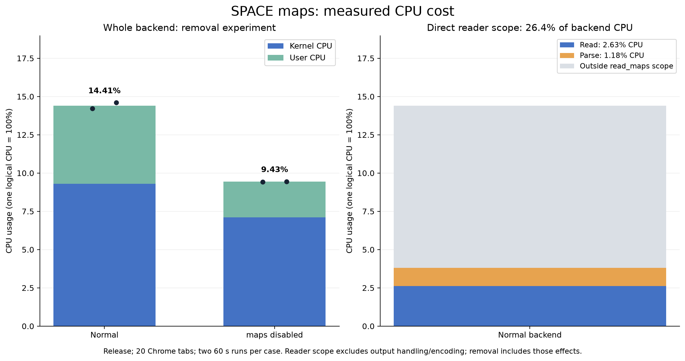

# SPACE maps CPU attribution

This report measures the CPU cost of reading and parsing maps separately from
whole-backend CPU and from the effect of removing maps altogether. The base is
main [`7bb1b8a`](https://github.com/akawashiro/procinsh/commit/7bb1b8a13cafbb0d6ca31b549dd507fdd8ed9036)
with the experiment-only [patch](experiment.patch). Application source and
defaults in this PR are unchanged. The binary-map reader, ASCII parser and
frequency experiments in PRs #227–#229 are not included in this executable.

**Reading and parsing maps consumes 3.80% of one logical CPU, or 26.4% of the backend's total CPU time.**
These direct timings cover the normal SPACE workload; they are independent
of the change in observer behavior when maps are removed.



| Directly timed normal-path phase | CPU usage | Share of whole backend CPU |
|---|---:|---:|
| Read `/proc/PID/maps` | 2.63% | 18.2% |
| Parse text / allocate maps / drop input buffer | 1.18% | 8.2% |
| Combined maps reader | 3.80% | 26.4% |

The scope covers 5,297 calls and 3,329,344 mapping lines across two 60-second intervals.
There are 7 unsuccessful reads, included in the timings, and 0 boundary calls excluded.
Read accounts for 69.1% of scoped maps CPU and parsing accounts for 30.9%.

| Whole-backend variant | Mean CPU | Individual 60 s runs | Observed scan period |
|---|---:|---|---:|
| normal | 14.41% | 14.22%, 14.60% | 1.135 s |
| no_maps | 9.43% | 9.42%, 9.45% | 1.092 s |

Removing maps reduces observed whole-backend CPU by 4.97 percentage points (34.5% relative).
This broader difference includes downstream map comparison/encoding/drop
and observer feedback, as well as the reader. It must not be treated as
a direct measurement of read/parsing CPU or of serialization alone.
The remaining backend CPU includes discovery, FD/socket collection,
activity handling and delivery.

All four trials retain 20 workload tabs and active snapshots/activity.
No observer errors, map errors or SSE gaps appear at the observer readings;
all four sensors report observing, and FD collection continues.
Raw loss counters and page-health checks are included below in the data.

The separate perf recording contains **916 leaf samples**, of which
62.45% are in the kernel DSO. This is consistent with the large kernel-time
component of whole-backend CPU, but leaf symbols do not isolate all inclusive
maps cost. The scoped clocks above provide the reader attribution; perf is a
separate diagnostic and is not used to turn individual self symbols into a
maps CPU percentage.

## What the direct scope measures

The instrumented [`read_maps`](../../../src/http_server/process/maps.rs) uses
`CLOCK_THREAD_CPUTIME_ID` around two consecutive phases:

1. `fs::read_to_string("/proc/PID/maps")`: path formatting, open/read/close,
   buffer allocation and UTF-8 validation, including kernel work charged to this
   calling thread.
2. Parsing the returned text into `Vec<MemoryMap>`, including output allocations
   and dropping the input text buffer.

These are CPU time measurements, not elapsed wall time. Other threads' CPU,
scheduling delays and I/O wait are excluded. The read phase is **not a pure
kernel-time measurement**; it also includes userspace library work. The phases
do not include later output truncation/drop, map comparison/delta construction,
JSON encoding, compression or delivery.

Each call records monotonic begin/end timestamps, phase CPU nanoseconds, target
PID, bytes, row count and success in a thread-local buffered JSONL writer.
Recording happens after both measured phases. The buffer is flushed when the
snapshot worker exits during graceful shutdown. Clock calls and recording still
add overhead to the full backend measurement; it is not subtracted from the
reported process CPU. The clock calls within measured boundaries also contribute
a small measurement overhead to phase timings.

Only spans entirely inside the matching `/proc/PID/stat` CPU interval enter the
scope totals. Boundary-overlapping spans are excluded and counted separately.
This avoids charging warmup or the later perf recording to the CPU interval.
The included scope is a lower bound if a boundary call is excluded. No map
addresses, paths or file contents are saved in these timing records.

## Whole-backend removal experiment

The same release executable runs four trials in the order
`normal, no_maps, no_maps, normal`. In `no_maps`, only the structural snapshot
call to `memory_maps(pid)` is skipped; snapshots contain empty maps arrays.
Process discovery, FD/socket collection, activity sensors and publication remain
active. The observer verifies both that maps are empty and that FD collection
continues. This variant intentionally removes a SPACE feature and is only a
diagnostic experiment, not a proposed product change.

The difference in process CPU includes reading/parsing, later map handling and
the change in observer rendering/workload. It is **not an isolated timing of
map parsing or of JSON encoding**. The snapshot loop retains main's one-second
wait after collection, so a faster collection can cause more scans per minute;
observed snapshot periods and counts are reported. The direct scope gives a
separate measurement of just the maps reader on the normal path.

## Workload and counters

- AMD Ryzen 9 5950X, 32 logical CPUs; kernel 7.0.0-38-generic.
- Rust 1.98.1, ordinary Cargo release profile with thin LTO and locked dependencies.
- A persistent Chrome 141.0.7390.65 opens the first 20 sites from
  [`chrome_sites.txt`](../../../scripts/chrome_sites.txt), disables cache and
  reloads every 10 seconds. A separate Chrome displays `/space` at 1280×900
  using SwiftShader. Both browsers and the load generator run in the same
  private PID/network container as the backend.
- Each fresh backend starts through `scripts/dev_run.sh`. After the SPACE stream
  is ready, warmup is 30 seconds and process CPU measurement is 60 seconds.
- Process `utime + stime` deltas cover all backend threads; Chrome, controller
  and CPU-reader CPU are excluded. One logical CPU is 100%. Means sum CPU
  seconds over both trials and divide by summed actual elapsed seconds.
- No builds, tests or external perf recorders run during those CPU intervals.
  A separate 30-second, 199 Hz, leaf-only `cpu-clock` perf recording follows the
  final normal CPU interval and is not used as the direct attribution estimate.
- SSE counters/timestamps, inspected FD and process counts, map counts/errors,
  sensor health, loss counters and workload page checks are retained in
  [measurements.json](measurements.json). The observer readings bracket the CPU
  interval; SSE timestamps therefore slightly precede/follow the counter reads.

These results are specific to this live workload. There are two trials per
variant; websites, process counts and mapping contents are not frozen. BPF
programs observe host TGIDs while procfs uses private PIDs, so event attribution
is incomplete. Backend PID CPU also excludes BPF execution charged to other
tasks. Sensor health does not establish loss-free or host-equivalent recording.

## Evidence and reproduction

- [experiment.patch](experiment.patch): timers plus the maps-removal switch,
  applicable to base main. It does not change public interface signatures.
- [build.sh](build.sh): frontend and release build inside the test image.
- [measure.mjs](measure.mjs): workload, observer, CPU intervals and assertions.
- [cpu.py](cpu.py): whole-process counters and per-thread diagnostics; short-lived
  threads can be absent from diagnostics, but process counters are authoritative.
- [summarize.py](summarize.py): scoped CPU, process CPU, cadence and health totals.
- [plot.py](plot.py): Matplotlib PNG; [summary.json](summary.json) is its input.
- [provenance.json](provenance.json): executable, input and source hashes.
- [cpu-samples/](cpu-samples/): raw per-second process/thread counters.
- [maps-samples/](maps-samples/): buffered per-call scope records, including warmup
  and diagnostic perf time; only timestamp-filtered records enter the summary.
- [perf.json](perf.json), [perf-leaves.txt.gz](perf-leaves.txt.gz) and
  [analyze_perf.py](analyze_perf.py): leaf-only symbol/DSO counts. They are not
  an inclusive maps callgraph. The published stream normalizes PID, time, IP and
  DSO paths while preserving sample symbols and counts.
- [run.log](run.log): trial, result and separate perf timestamps.

The controller expects `/experiment/source/scripts/chrome_load.mjs` and its
site list, `/experiment/cpu.py` and the selected executable at
`/experiment/runtime/experiment-release/target/debug/procinsh`, launched by the
copied `scripts/dev_run.sh`. That fixed `target/debug` path contains the
**release** executable in this experiment. It sets
`PROCINSH_EXPERIMENT_MAPS_LOG` for every backend and additionally
`PROCINSH_EXPERIMENT_NO_MAPS=1` for the two removal trials.

The runtime is the local image `procinsh-isolated-perf:20261017T040238Z`, with
private PID and bridge network namespaces, DNS 1.1.1.1, read-only root, 1 GiB
`/tmp` tmpfs, 256 MiB shared memory, unlimited memlock, 8 GiB memory and 2048 PIDs.
Drop all default capabilities, then add `PERFMON`, `SYS_PTRACE`, `BPF`,
`DAC_READ_SEARCH`, `SYSLOG`, `IPC_LOCK`, `SETUID`, `SETGID`, `CHOWN` and `KILL`,
with `seccomp=unconfined`. Mount the experiment directory at `/experiment`.
This runtime image is local, not a published reproduction image.

```sh
docker exec procinsh-maps-cost node /experiment/measure.mjs
python3 summarize.py measurements.json summary.json
python3 plot.py
```

Before measurement, the patched source passes Docker `checks` and `ordinary`
using `bash scripts/docker_test.sh --network host`: format, Clippy, rustdoc,
documentation/package checks, all 99 Rust unit tests, 4 build-Git integration
tests, 1 HTTP integration test, 107 frontend tests and listen/dev-server checks.
No Rust tests are ignored or skipped. Raw perf data, screenshots, logs and the
exact executable remain under `/tmp/procinsh-maps-cost-profile` locally.
