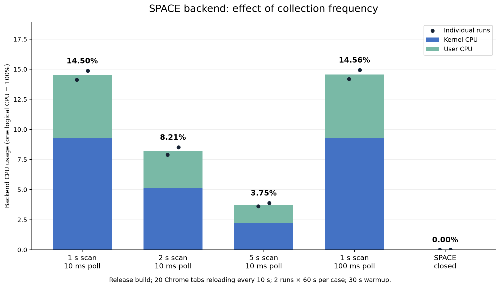

# SPACE backend CPU versus collection frequency

This experiment measures how SPACE backend CPU depends on the structural scan
period and on event-buffer polling. It uses main
[`7bb1b8a`](https://github.com/akawashiro/procinsh/commit/7bb1b8a13cafbb0d6ca31b549dd507fdd8ed9036),
with the experiment-only [patch](experiment.patch). The application source and
its scheduling defaults in this PR are unchanged. The map-parser change in
[PR #228](https://github.com/akawashiro/procinsh/pull/228) and the binary-map
experiment in [PR #227](https://github.com/akawashiro/procinsh/pull/227) are not
included in the measured binary.

**Whole-backend CPU falls from 14.50% to 8.21% (43.4% less) with a two-second scan wait, and to 3.75% (74.1% less) with a five-second scan wait.**
The activity publication threshold stays at one second. The large decline
tracks the observed structural scan frequency on this workload.



| Condition | Observed scan period | Backend CPU | Individual 60 s runs | CPU change vs 1 s |
|---|---:|---:|---|---:|
| 1 s scan / 10 ms poll | 1.137 s | 14.50% | 14.13%, 14.87% | reference |
| 2 s scan / 10 ms poll | 2.135 s | 8.21% | 7.90%, 8.52% | -43.4% |
| 5 s scan / 10 ms poll | 5.142 s | 3.75% | 3.62%, 3.88% | -74.1% |
| 1 s scan / 100 ms poll | 1.138 s | 14.56% | 14.18%, 14.93% | +0.4% |
| SPACE closed | — | 0.00% | 0.00%, 0.00% | -100.0% |

The inactive control consumes no process CPU ticks during either 60-second
interval (0.00% at this measurement resolution). This is not a claim of
zero machine-wide overhead from all running software.

**Increasing the event-buffer poll sleep to 100 ms provides no established
CPU reduction.** Its two CPU runs overlap the baseline range and its file
event loss counter grows much faster:

| Condition | `files_lost` increase in each 60 s run |
|---|---|
| 1 s scan / 10 ms poll | 816, 1,379 |
| 2 s scan / 10 ms poll | 1,788, 416 |
| 5 s scan / 10 ms poll | 895, 2,148 |
| 1 s scan / 100 ms poll | 395,360, 393,199 |

All active trials continue to publish snapshots and activity, report all four
sensors as observing, and have no observer errors, map errors or SSE gaps.
IPC and signal loss counters do not increase in these intervals. File event
loss exists even at the default poll setting; observing does not mean
loss-free. The 20 workload tabs stay present, with no Chrome error pages
or navigation errors; challenge-page counts observed after trials: [2].
Private-PID event attribution remains incomplete as explained below.

## Which frequencies are changed

[`system/service.rs`](../../../src/http_server/system/service.rs) has three
separate clocks:

- The snapshot worker collects the process list, maps and FD/socket relations,
  publishes the result, then waits **at least one second** before its next scan.
  The effective period includes collection time and the 100 ms scheduling check.
- The activity worker consumes file, IPC and signal event buffers, then sleeps
  **10 ms**. The effective polling period also includes processing time.
- The activity worker drains/aggregates and publishes activity about once per
  second. CPU sensor collection happens during this drain. This publication
  threshold remains one second in every active case in this experiment.

The patch reads `PROCINSH_EXPERIMENT_SNAPSHOT_MS` and
`PROCINSH_EXPERIMENT_POLL_MS` once when the corresponding worker starts. Each
trial uses the **same executable** and changes only those environment variables
and whether the observer opens SPACE. The patch retains the existing initial
scan, wakeups, snapshot collection logic, sensor implementation and encoding.
The 100 ms poll condition changes the event loop's sleep; it can also slightly
shift activity publication timing. This is not a test of sending the same
collected data to the browser less often.

## Method

- AMD Ryzen 9 5950X, 32 logical CPUs, kernel 7.0.0-38-generic.
- Ordinary Cargo **release** build with Rust 1.98.1 and locked dependencies.
- Google Chrome 141.0.7390.65, Node 22.18.0, private container PID namespace and
  bridge network. The container has no CPU quota and an 8 GiB memory limit.
- A persistent Chrome workload has 20 tabs, using the first 20 entries of
  [`chrome_sites.txt`](../../../scripts/chrome_sites.txt), disables the network
  cache, and reloads every 10 seconds. A separate Chrome observes `/space` at
  1280×900 with SwiftShader; in the inactive control it stays on `about:blank`.
- A fresh backend is launched using `scripts/dev_run.sh` for every trial. The
  observer waits for a snapshot and two activity events, then warms up for 30
  seconds. Inactive controls warm up without a subscription.
- Each CPU interval is 60 seconds. `/proc/PID/stat` user plus system CPU deltas
  cover the **whole backend process, including all its threads**. Browser,
  controller and CPU-reader CPU are excluded. One logical CPU is 100%; these
  numbers are not percentages of the entire 32-CPU machine. No external perf
  recorder, build or test runs during these intervals.
- Order: `s1, s2, s5, p100, idle, idle, p100, s5, s2, s1`.
  Reversing the order reduces simple chronological drift. Every case has two
  independent 60-second intervals, but the live browser workload is not frozen.
- SSE counters and timestamps, process/map counts, map errors, browser page
  health, sensor states and event-loss counters are retained in
  [measurements.json](measurements.json). Reported SSE mean periods use only
  consecutive arrivals between the observer readings bracketing a CPU interval,
not configured sleep durations. These observer readings slightly precede/follow
the process-counter measurement.

The mean CPU values sum user/system CPU seconds across both runs and divide by
their summed actual elapsed time. The fit in [summary.json](summary.json), when
present, is a descriptive line through the three structural-scan group means;
it is not a statistical significance test or an extrapolation guarantee.

## Scope and limitations

These measurements answer the effect on the backend PID in this container and
workload. They do not include BPF execution charged to other tasks or Chrome's
CPU/GPU use. The sensors attach successfully, but BPF host TGIDs and private
procfs PIDs are different namespaces, so some events cannot be attributed to
container processes. Sensor health alone does not establish host-equivalent
attribution or loss-free recording. Raw health deltas are reported rather than
assuming unchanged event fidelity when a poll interval increases.

Websites, renderer process counts, mapping counts, and background activity vary
during the run. There are only two repetitions per case. Large differences
between cases support a frequency-dependence conclusion on this workload; small
differences and absolute CPU values should not be generalized to every machine.
The frequency sweep includes the whole structural scan and its resulting
encoding/delivery; it does not isolate the maps reader from FD/socket collection
or from activity induced by those reads. A slower structural scan also delays
process, mapping and FD/socket updates,
including new process identities used for activity attribution.

## Reproduction and evidence

The exact input patch and controller are included:

- [experiment.patch](experiment.patch): apply to base main `7bb1b8a` only for the
  experiment; it is not part of the application's compiled source in this PR.
- [build.sh](build.sh): builds the frontend and the experiment release binary
  inside `procinsh-tests:ubuntu-24-04`, with `/experiment/source` as its input.
- [measure.mjs](measure.mjs): persistent workload, observer, per-trial settings,
  warmup, CPU reader and assertions. Run as root inside the experiment container;
  it launches the two browsers as UID/GID 1000.
- [cpu.py](cpu.py): process counters plus one-second per-thread diagnostics.
  The process counter is authoritative; thread diagnostics can miss short-lived
  threads between samples.
- [summarize.py](summarize.py): aggregates CPU, observed cadence and health.
- [plot.py](plot.py): creates the mobile-viewable PNG with Matplotlib 3.11.2.
- [provenance.json](provenance.json): executable/input hashes and build/runtime
  identity. The runtime image is local, not a published image reference.

The controller expects `/experiment/source/scripts/chrome_load.mjs` and its
site list, `/experiment/cpu.py`, and an executable selected by
`/experiment/runtime/experiment-release/scripts/dev_run.sh` at
`/experiment/runtime/experiment-release/target/debug/procinsh`. This last path
holds the **release** executable because `dev_run.sh` uses a fixed binary path.
Build it with `cargo build --release --locked` after applying the patch; the
frontend is built with `npm ci` and `npm run build` in `web/`.

The runtime container configuration is private PID + bridge network, DNS
1.1.1.1, read-only root filesystem, 1 GiB `/tmp` tmpfs, 256 MiB shared memory,
unlimited memlock, 8 GiB memory and 2048 PIDs. Drop all default capabilities,
then add `PERFMON`, `SYS_PTRACE`, `BPF`, `DAC_READ_SEARCH`, `SYSLOG`, `IPC_LOCK`,
`SETUID`, `SETGID`, `CHOWN`, and `KILL`, with `seccomp=unconfined`. Mount the
experiment directory read/write at `/experiment`. All workloads and collection
run inside that container.

```sh
docker exec procinsh-space-frequency node /experiment/measure.mjs
python3 summarize.py measurements.json summary.json
python3 plot.py
```

The patched source passed `bash scripts/docker_test.sh --network host checks`
and `ordinary`: formatting, Clippy, rustdoc, documentation/package checks,
99 Rust unit tests, 4 build-Git integration tests, 1 HTTP integration test,
107 frontend tests, and listen/development-server checks. No Rust tests were
ignored or skipped. These checks finish before CPU measurement begins.

Raw per-second process/thread counter records are in [cpu-samples/](cpu-samples/).
Browser screenshots and logs, exact executable, and the build checkout are kept
locally under `/tmp/procinsh-space-frequency-profile`; executable hashes make
clear which artifact was used.
